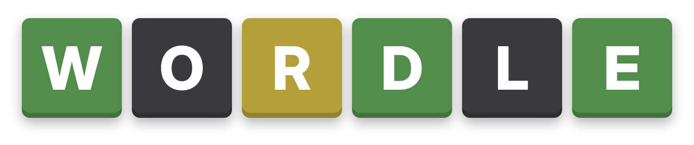
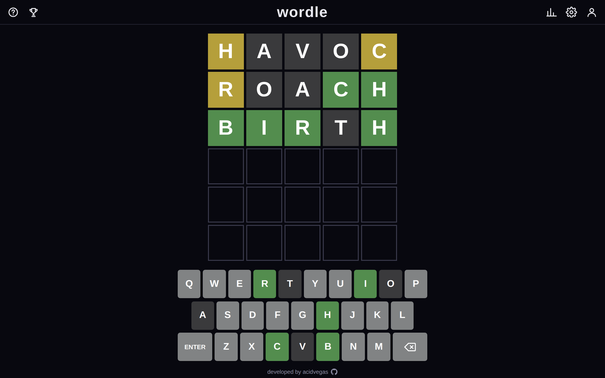
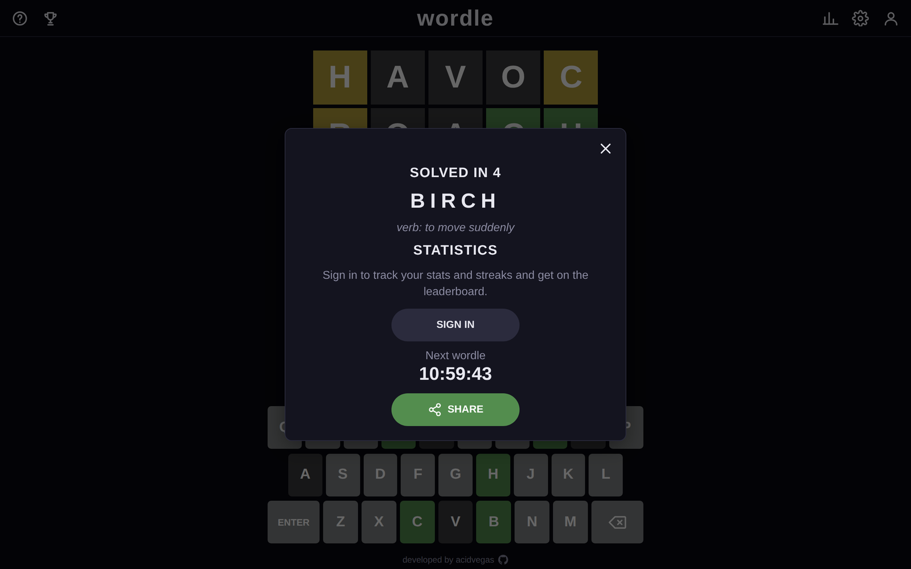
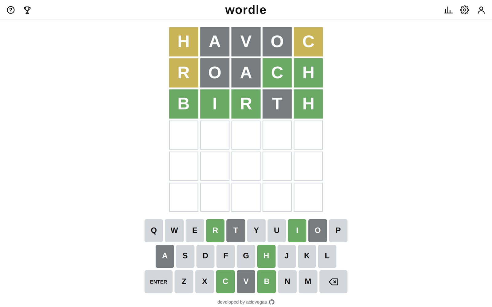
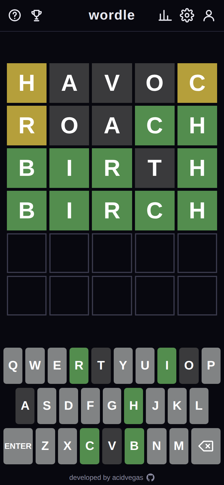

<h1 align="center">
  
</h1>

<p align="center"><b>Open source Wordle in the browser, built with Flask.</b></p>

<p align="center">
  <a href="https://wordle.supernets.org"></a>
</p>

<p align="center">
  
  
  
  
  
  <a href="LICENSE"></a>
</p>

<p align="center">
  
</p>

Guess the hidden 5-letter word in 6 tries. There is one word for everyone each day, and a new one comes out at midnight UTC.

## Screenshots

<table>
  <tr>
    <td width="50%"></td>
    <td width="50%"></td>
  </tr>
  <tr>
    <td align="center"><i>The answer and its definition when the game ends</i></td>
    <td align="center"><i>Light theme</i></td>
  </tr>
</table>

<p align="center">
  <br>
  <i>Playing on a phone</i>
</p>

## Features

- One daily puzzle for the whole world, scored on the server. The answer is never sent to the browser until your game is over, so it can't be read out of the page.
- Hard mode *(revealed hints must be used in later guesses, picked before the first guess)*
- Dark and light themes, plus a high contrast mode *(orange and blue instead of green and yellow)*
- Share your result as an emoji grid, using the share sheet on phones
- The answer's definition is shown when the game ends
- Works on phones: on-screen keyboard, fits any screen size, installs to the home screen as an app
- Optional accounts *(username, password and a captcha)* with stats, streaks, a guess distribution and leaderboards for today, current streak and all-time
- An API so bots *(IRC, Discord, ...)* can play with an account's API key

Guests play by IP address and get no stats. Their board for the day is stored on the server, so refreshing or clearing the browser doesn't give a new try. If a guest signs in, their board moves to the account when it went further than the account's own board for the day *(a finished guest board always does)*, so a guest game can't be used to look at the answer before playing a ranked one. Each guest board can only move to one account.

## Word lists

| File                       | Contents                                                                                  |
|----------------------------|-------------------------------------------------------------------------------------------|
| `wordle/words/words.txt`   | Every 5-letter word in NWL2023 *(9,476)* with its definition. These are the valid guesses |
| `wordle/words/answers.txt` | 2,146 possible answers                                                                    |

The answers are the most common NWL2023 5-letter words, ranked with the [wordfreq](https://github.com/rspeer/wordfreq) word frequency data. Plurals, past tenses, names, brands, slang, British spellings and offensive words were removed by hand.

The order of the answers is shuffled with a random seed made on first run and kept in the database, so the list being public doesn't give away which word comes next. Puzzle #1 is November 3, 2026.

## API

Sign in, open the account panel and create an API key. A new key replaces the old one. The bot plays as your account: its guesses go on your daily board and count toward your stats and leaderboard spots.

Send the key in the `Authorization` header:

```bash
curl -H 'Authorization: Bearer wdl_...' https://wordle.supernets.org/api/state

curl -H 'Authorization: Bearer wdl_...' -H 'Content-Type: application/json' -d '{"guess": "crane"}' https://wordle.supernets.org/api/guess
```

| Endpoint       | Method | Body                                             | Returns                      |
|----------------|--------|--------------------------------------------------|------------------------------|
| `/api/state`   | GET    |                                                  | Today's game                 |
| `/api/guess`   | POST   | `{"guess": "crane", "hard": false, "puzzle": 1}` | Today's game after the guess |
| `/leaderboard` | GET    | `?board=today`, `streak` or `alltime`            | The top 50 players           |

`hard` is only read on the first guess of the day. `puzzle` is optional: send the puzzle number you think you're playing, and the guess is refused with a 409 if a new puzzle has come out since. A game looks like this:

```json
{
	"puzzle"      : 1,
	"date"        : "2026-11-03",
	"max_guesses" : 6,
	"hard"        : false,
	"guesses"     : [{"word": "CRANE", "result": ["correct", "absent", "present", "absent", "present"]}],
	"solved"      : false,
	"over"        : false,
	"next_in"     : 10534
}
```

`next_in` is the number of seconds until the next puzzle. Once `over` is true, `answer` and `definition` are included too. Errors come back as `{"error": "not in word list"}` with a 400 status *(401 for a bad key, 409 when the game is already over)*. Guesses that aren't valid words don't use up a try.

## Requirements

- Python 3.12+
- [Flask](https://pypi.org/project/Flask/)
- [gunicorn](https://pypi.org/project/gunicorn/) with the [gevent](https://pypi.org/project/gevent/) worker

## Running locally

```bash
python3 -m venv .venv
.venv/bin/pip install -r requirements.txt
cd wordle
../.venv/bin/gunicorn --worker-class gevent --workers 1 --bind 127.0.0.1:20004 app:app
```

Captchas and rate limits *(10 failed logins per account or 30 per IP in 15 minutes, 5 signups per IP an hour, 30 captchas per IP a minute)* live in memory, so always run a single worker.

## Running with Docker

```bash
./setup.sh
```

This builds the `wordle` image and starts a container bound to `127.0.0.1:20004` with the `wordle_data` volume mounted at `/data`. Three environment variables change how it runs:

| Variable            | Default     | What it does                                                                                                                                                                                                          |
|---------------------|-------------|-----------------------------------------------------------------------------------------------------------------------------------------------------------------------------------------------------------------------|
| `WORDLE_BIND`       | `127.0.0.1` | Address the port is published on                                                                                                                                                                                      |
| `WORDLE_PROXIES`    | `0`         | Number of reverse proxies in front of the app. `setup.sh` sets `1`, since it publishes the port on 127.0.0.1 for nginx                                                                                                   |
| `WORDLE_PUBLIC_URL` |             | Main address of the site, e.g. `https://wordle.acid.vegas`. Canonical links, share cards, robots.txt and the sitemap use it instead of the request host, so a site served on more than one domain isn't indexed twice |

Behind a reverse proxy, `WORDLE_PROXIES` has to be set, or every guest shares the proxy's IP and the same board. Don't set it when the app is reached directly, since anyone could then fake their IP with an `X-Forwarded-For` header.

## acid-arcade-db

By default wordle keeps its own accounts. It can instead use acid-arcade-db, a shared account server, so one username and password works on every acid-arcade game. Each site still logs in on its own.

Setting `ARCADE_URL` turns this on. Signups, logins and sessions then go through acid-arcade-db, the local `users` table becomes a copy of those accounts, and each finished daily game sends your streak, win % and other stats to your arcade profile. It is also reported as a `finish` activity *(solved, guesses, hard mode and streak, all from the server's own record of the game)*, so solving the daily puzzle earns casino chips *(more for fewer guesses, plus a streak bonus)* and counts toward the arcade's daily missions. Renames and deletions made on the account server are picked up every minute. API keys stay in wordle. If the account server can't be reached, signed in requests get a 503 instead of falling back to guest play.

| Variable            | Default                   | What it does                                                                                                                                                                      |
|---------------------|---------------------------|-----------------------------------------------------------------------------------------------------------------------------------------------------------------------------------|
| `ARCADE_URL`        |                           | Internal acid-arcade-db address, e.g. `http://acid-arcade-db:20021`                                                                                                               |
| `ARCADE_PUBLIC_URL` | `https://arcade.{domain}` | Public site, used for profile pictures and the account settings link. `{domain}` becomes the player's own parent domain *(chess.supernets.org gets https://arcade.supernets.org)* |
| `ARCADE_GAME`       |                           | This game's slug in acid-arcade-db. `setup.sh` sets it to `wordle`                                                                                                                |
| `ARCADE_KEY`        |                           | This game's key, needed when acid-arcade-db has `ARCADE_GAME_KEYS` set                                                                                                            |

With `ARCADE_URL` set, `setup.sh` also joins the container to the `arcade` docker network and passes the other two variables. acid-arcade-db limits failed logins and signups per IP, so behind nginx set `WORDLE_PROXIES=1` or every player shares the proxy's address.

## Tests

```bash
.venv/bin/python tests/test_app.py
```

## Code layout

| Path                | Contents                                                           |
|---------------------|--------------------------------------------------------------------|
| `wordle/app.py`     | Flask routes, guesses, the API and the guest to account carry-over |
| `wordle/game.py`    | Daily answer, scoring, hard mode rules                             |
| `wordle/storage.py` | SQLite storage for users, games, stats and leaderboards            |
| `wordle/auth.py`    | Sessions, API keys and captcha                                     |
| `wordle/words.py`   | Word list loading                                                  |
| `wordle/static/`    | `utils.js`, `theme.js`, `style.css`, icons and the social preview image |
| `wordle/templates/` | `index.html`                                                       |
| `tests/`            | Scoring, hard mode and HTTP API tests                              |

## Data

Everything is written to `WORDLE_DATA_DIR`, which defaults to `data/` at the repo root. `wordle.db` holds accounts, sessions, every game and the answer seed. Losing the seed changes the order of every future answer.

---

###### Mirrors: [SuperNETs](https://git.supernets.org/acidvegas/) • [GitHub](https://github.com/acidvegas/) • [GitLab](https://gitlab.com/acidvegas/) • [Codeberg](https://codeberg.org/acidvegas/)
